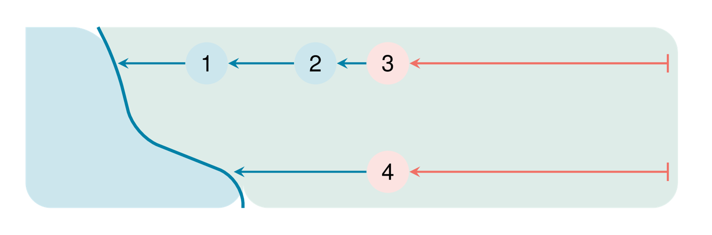
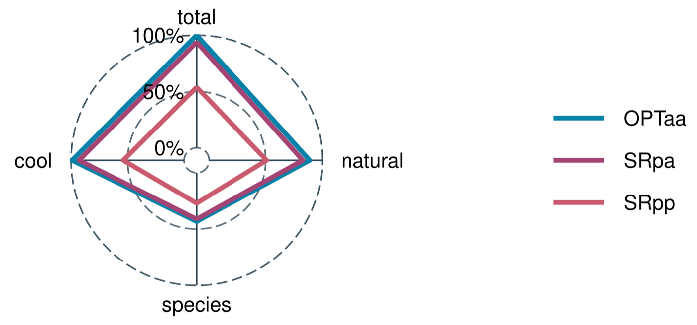
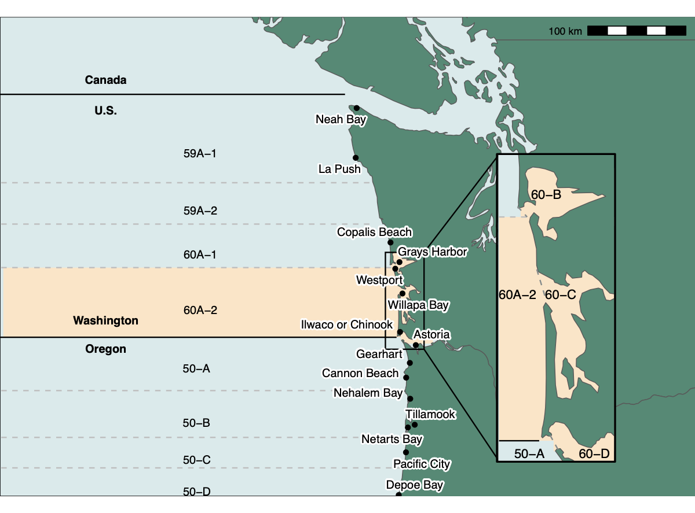
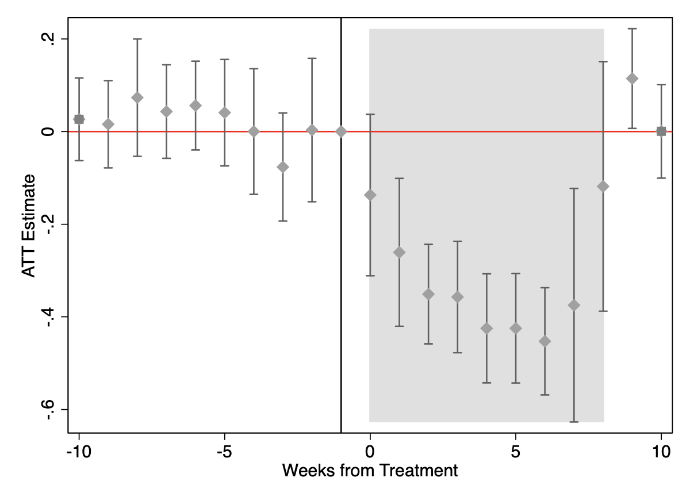

My research focuses on the economics of natural resource management in marine and coastal systems. Below are the two areas that take up most of my research time, with published work and ongoing projects for each. For a full list of publications and grants, see my [CV](https://www.dropbox.com/scl/fi/dyg9ur40kuuyb7eb3su94/Jardine_CV.pdf?rlkey=btdwlwrtm9v5cz4hpgm0dq9lw&raw=1) or [Google Scholar page](https://scholar.google.com/citations?user=h4BCQ3oAAAAJ&hl=en).

## Salmon Recovery

Anadromous salmon and steelhead in the Pacific Northwest (*Oncorhynchus* spp.) need access to streams throughout their spawning and rearing life stages. Barriers to fish passage, such as poorly designed culverts at road crossings, block access to habitat, harm salmon populations, and violate tribal treaty rights. Large investments in fish passage are underway in the region, but available funding falls well short of what it would cost to remove every barrier. My work asks how to spend restoration budgets so they deliver the most habitat.

### Recent work

**[Improving restoration heuristics to support anadromous fish passage](https://doi.org/10.1371/journal.pone.0348150)**, *PLOS One* (2026)

Managers often choose fish passage projects with simple score-and-rank rules rather than optimization. Because benefits depend on watershed connectivity, removing a barrier can produce no habitat gain if other barriers remain downstream, leaving a stranded investment (Figure 1). Using western Washington as a case study, we benchmark common heuristics against optimization. Ranking barriers by total upstream habitat achieves 93% of optimal gains when habitat quantity is the only objective. Adding common proxies for habitat quality, such as the percent of upstream habitat in natural land cover, cuts performance to 54-63% of optimal (Figure 2). Scaling habitat quality by the amount of habitat each barrier opens brings the heuristic back to 93-95% of optimal.

<figure>
  
  <figcaption>Figure 1. Stranded investments. Two simplified stream networks with barriers shown as numbered circles; the ocean is on the left. Blue barriers and stream segments are restored barriers and accessible habitat; red are remaining barriers and blocked habitat. From <a href="https://doi.org/10.1371/journal.pone.0348150">Jardine et al. (2026)</a>, <em>PLOS One</em>, <a href="https://creativecommons.org/licenses/by/4.0/">CC BY 4.0</a>.</figcaption>
</figure>

<figure>
  
  <figcaption>Figure 2. Habitat gains when both habitat quantity and quality are valued, as a percent of the best-performing approach, at a budget equal to 25% of total cost. Axes are total habitat, habitat in natural land cover, cool-water habitat, and habitat for species of interest. OPTaa is optimization; SRpp ranks barriers using proxies for connectivity and habitat quality; SRpa ranks barriers using a connectivity proxy with habitat quality scaled by habitat amount. Adapted from <a href="https://doi.org/10.1371/journal.pone.0348150">Jardine et al. (2026)</a>, <em>PLOS One</em>, Fig 6a, <a href="https://creativecommons.org/licenses/by/4.0/">CC BY 4.0</a>.</figcaption>
</figure>

### Ongoing work

- **Efficiency and equity in fish passage funding.** How much habitat is given up when restoration funds are spread across watersheds for geographic equity rather than targeted for efficiency, accounting for barriers that are only partially passable.
- **[Upstream](https://upstream-wca.app).** A web tool that lets planners explore cost-effective culvert restoration portfolios for western Washington.

### Publications

- Jardine, S.L., L. Blair, C. Burch, A. Cooke, R. Fonner, D.S. Holland, J. Kahn, C. Lewis-Smith, L.W. Rogers, M.D. Scheuerell, and B. Van Deynze. 2026. Improving restoration heuristics to support anadromous fish passage. *PLOS One*. [doi:10.1371/journal.pone.0348150](https://doi.org/10.1371/journal.pone.0348150)
- Burch, C.A., S.L. Jardine, C. Lewis-Smith, and B. Van Deynze. 2024. Who prioritizes what? A cross-jurisdictional comparative analysis of salmon fish passage strategies in Western Washington. *Conservation Science and Practice*, e13102. [doi:10.1111/csp2.13102](https://doi.org/10.1111/csp2.13102)
- Van Deynze, B., R. Fonner, B. Feist, S.L. Jardine, and D.S. Holland. 2022. What influences spatial variability in restoration costs? Econometric cost models for inference and prediction in restoration planning. *Biological Conservation*, 274, 109710. [doi:10.1016/j.biocon.2022.109710](https://doi.org/10.1016/j.biocon.2022.109710)

## Harmful Algal Blooms

Harmful algal blooms (HABs) of *Pseudo-nitzschia* produce domoic acid, a toxin that accumulates in shellfish and has repeatedly disrupted the West Coast Dungeness crab fishery, the most valuable fishery on the coast. The unprecedented 2015/16 bloom, which delayed and closed the California fishery, began more than a decade of chronic disruptions, including delayed season openings, area closures, and evisceration orders. My work measures the economic impacts of these events on markets, fishing businesses, and communities, and evaluates management responses that can reduce the losses.

### Recent work

**[Price impacts of evisceration orders in the Dungeness crab fishery](https://doi.org/10.22004/ag.econ.401347)**, *Journal of Agricultural and Resource Economics* (2026)

Instead of closing the fishery during a HAB, some states issue evisceration orders, which allow harvest if the toxin-containing viscera are removed before sale. Using Washington's 2021 evisceration order and a difference-in-differences design, we estimate its effect on ex-vessel prices. Evisceration orders preserve fishing opportunities, but they substantially reduce the market value of the catch (Figure 4).

<figure class="half">
  
  
  <figcaption>Figure 3 (left). Washington and northern Oregon Dungeness crab harvest areas and ports; the shaded area was under the 2021 evisceration order. Figure 4 (right). Event-study estimates of the evisceration order's effect on log ex-vessel price by week relative to the order, with confidence intervals. The shaded period is when the order was in effect. From <a href="https://doi.org/10.22004/ag.econ.401347">Abken and Jardine (2026)</a>, <em>Journal of Agricultural and Resource Economics</em>, <a href="https://creativecommons.org/licenses/by-nc/4.0/">CC BY-NC 4.0</a>.</figcaption>
</figure>

### Ongoing work

- **Adaptive responses and vulnerability to chronic HAB disruptions.** A multi-institution project (2026-2029, funded by NOAA's National Centers for Coastal Ocean Science) studying how West Coast fishing businesses and communities adapt to recurring HAB disruptions, and who is most vulnerable to them.

### Publications

- Abken, A., and S.L. Jardine. 2026. Price impacts of evisceration orders in the Dungeness crab fishery. *Journal of Agricultural and Resource Economics*. [doi:10.22004/ag.econ.401347](https://doi.org/10.22004/ag.econ.401347)
- Jardine, S.L., K. Bland, and A.L. Hayes. 2024. Fishing portfolio response to a climate shock. *Marine Resource Economics*, 39(2), 79-100. [doi:10.1086/728919](https://doi.org/10.1086/728919)
- Fisher, M.C., S.K. Moore, S.L. Jardine, J.R. Watson, and J.F. Samhouri. 2021. Climate shock effects and mediation in fisheries. *Proceedings of the National Academy of Sciences*, 118(2). [doi:10.1073/pnas.2014379117](https://doi.org/10.1073/pnas.2014379117)
- Jardine, S.L., M. Fisher, S. Moore, and J. Samhouri. 2020. Inequality in the economic impacts from climate shocks in fisheries: the case of harmful algal blooms. *Ecological Economics*, 176, 106691. [doi:10.1016/j.ecolecon.2020.106691](https://doi.org/10.1016/j.ecolecon.2020.106691)
- Moore, S., S.J. Dreyer, J.A. Ekstrom, K. Moore, K. Norman, T. Klinger, E.H. Allison, and S.L. Jardine. 2020. Harmful algal blooms and coastal communities: socioeconomic impacts and actions taken to cope with the 2015 U.S. West Coast domoic acid event. *Harmful Algae*, 96, 101799. [doi:10.1016/j.hal.2020.101799](https://doi.org/10.1016/j.hal.2020.101799)
- Mao, J., and S.L. Jardine. 2020. Market impacts of a toxic algae event: the case of California Dungeness crab. *Marine Resource Economics*, 35(1), 1-20. [doi:10.1086/707643](https://doi.org/10.1086/707643)
- Moore, K.M., E.H. Allison, S.J. Dreyer, J.A. Ekstrom, S.L. Jardine, T. Klinger, S.K. Moore, and K.C. Norman. 2020. Harmful algal blooms: identifying effective adaptive actions used in fishery-dependent communities in response to a protracted event. *Frontiers in Marine Science*, 6, 803. [doi:10.3389/fmars.2019.00803](https://doi.org/10.3389/fmars.2019.00803)
